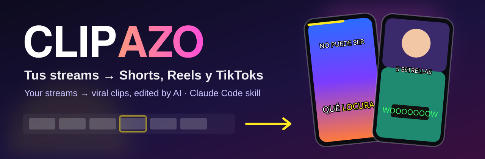
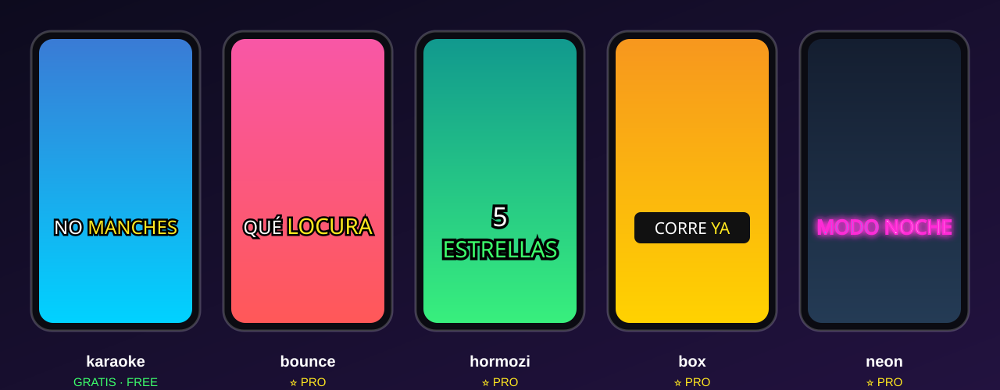
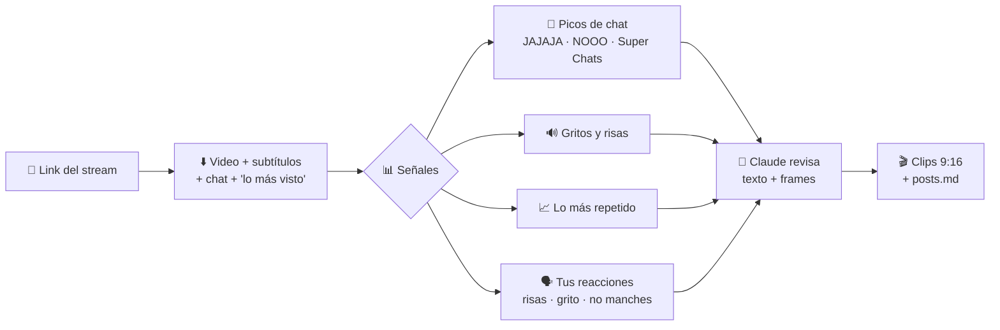

<p align="center">
  
</p>

<p align="center">
  <a href="#instalación"></a>
  
  
  
  <a href="#-clipazo-pro"></a>
</p>

<h3 align="center">Pega el link de tu stream y recibe clips verticales listos para subir.<br>Con subtítulos animados, título gancho y el texto para publicar.</h3>

<p align="center"><a href="#español">Español</a> · <a href="#english">English</a></p>

---

## Español

**Clipazo** es una *skill* para [Claude Code](https://claude.com/claude-code). Terminas tu directo,
le pasas el link de YouTube y Claude hace de editor: encuentra los mejores momentos, los corta, los
pone en vertical con subtítulos y te escribe los títulos y hashtags.

```
> Sácame 8 clips para Shorts y Reels de mi stream: https://youtube.com/watch?v=...
```

### ✨ Qué recibes

| | |
|---|---|
| ✂️ **Clips verticales 9:16** | 1080×1920 para YouTube Shorts, Instagram Reels y TikTok |
| 💬 **Subtítulos animados** | palabra por palabra, con la palabra actual resaltada |
| 🪝 **Título gancho** | arriba del clip, para atrapar a quien va pasando |
| 🎥 **3 layouts** | **facecam** (tu cámara arriba y el gameplay abajo), **blur** o **crop** a pantalla completa |
| 🔊 **Audio listo para publicar** | normalizado a −14 LUFS, con fade in y fade out |
| 📝 **`posts.md`** | títulos, descripciones, tags y hashtags por plataforma, más el link al momento exacto del VOD |
| 📺 **Recopilación** | "mejores momentos" en horizontal con capítulos para tu canal principal |

<p align="center"></p>

### 🧠 ¿Cómo elige los momentos?

No corta al azar. Cruza cuatro señales y después **Claude decide como editor**: lee lo que dijiste,
mira los frames y descarta menús, pantallas de carga y despedidas.



### Instalación

**1. Requisitos** (la skill lo revisa todo con `doctor.py` y te dice qué falta):

```powershell
# Windows
winget install Gyan.FFmpeg
python -m pip install -U "yt-dlp[default]"
```
```bash
# macOS
brew install ffmpeg deno && python3 -m pip install -U "yt-dlp[default]"
```

**2. Instala Clipazo.** Dentro de Claude Code:

```
/plugin marketplace add luis16112004/clipazo
/plugin install clipazo@clipazo
```

<details><summary>O de forma manual</summary>

```bash
git clone https://github.com/luis16112004/clipazo
cp -r clipazo/skills/clipazo ~/.claude/skills/
```
</details>

### Uso

> Sácame 8 clips de este stream: https://youtu.be/XXXX. Tengo la facecam abajo a la izquierda.

> Ya descargué el video en D:\Videos\gta6.mp4 (es este stream: https://youtu.be/XXXX). Hazme clips y una recopilación para YouTube.

Claude te muestra los momentos que eligió y por qué, renderiza todo en `clips/` y te deja el texto listo
en `posts.md`.

---

## ⭐ Clipazo PRO

**Lo mismo, pero con clips que parecen editados a mano.** PRO es un add-on que se instala encima de la
versión gratis, y Claude lo usa automáticamente.

| | Gratis | ⭐ PRO |
|---|:---:|:---:|
| Detección de mejores momentos (chat, audio, lo más visto, voz) | ✅ | ✅ |
| Clips 9:16 + horizontal, 3 layouts, recopilación con capítulos | ✅ | ✅ |
| Subtítulos animados (karaoke) + título gancho | ✅ | ✅ |
| `posts.md` con títulos y hashtags | ✅ | ✅ |
| 🎨 **4 estilos de subtítulos extra**: bounce, hormozi, box, neon | — | ✅ |
| 🔍 **Zoom punch-in** automático en gritos, risas y picos de audio | — | ✅ |
| 💥 **Efectos de sonido** (whoosh, boom, ding) sin copyright | — | ✅ |
| 📊 **Barra de progreso** que mejora la retención | — | ✅ |
| 🏷️ **Tu marca**: @usuario, logo y tarjeta final "Sígueme" | — | ✅ |
| 🖼️ **Miniaturas** 9:16 y 16:9 con texto gigante | — | ✅ |
| 🧠 **3 hooks alternativos** por clip para A/B test | — | ✅ |
| 🌎 **Versión en inglés** de títulos y descripciones, para duplicar el alcance | — | ✅ |
| 📅 **Plan de publicación** de 7 días | — | ✅ |
| Actualizaciones y nuevas funciones primero | — | ✅ |

<p align="center">
  <a href="https://github.com/sponsors/luis16112004"></a>
</p>

Al patrocinar en el nivel PRO recibes acceso automático al repositorio privado `clipazo-pro`. Se
instala con un solo comando y se actualiza con `git pull`.

---

### ❓ Preguntas frecuentes

<details><summary><b>¿Es gratis?</b></summary>
La skill es gratis y de código abierto (MIT). Necesitas Claude Code, que requiere una cuenta de Claude.
PRO es opcional.</details>

<details><summary><b>¿Necesito una PC potente o GPU?</b></summary>
No. El análisis de un stream de 6 h tarda 2–3 minutos y cada clip se renderiza en 1–2 veces su
duración. Whisper (transcripción local) va más rápido con GPU, pero solo se usa si YouTube no
generó subtítulos.</details>

<details><summary><b>¿Funciona con Twitch?</b></summary>
Sí, con links de VODs de Twitch, pero sin chat ni "lo más visto". Si transmites en ambos (como en un
simulcast), usa el VOD de YouTube: trae el chat y los subtítulos.</details>

<details><summary><b>¿Sube los videos por mí?</b></summary>
No, te deja los archivos y el texto listos. Tú los publicas y conservas el control de tus cuentas.</details>

<details><summary><b>¿Mis videos se suben a algún servidor?</b></summary>
No. Todo corre en tu computadora con ffmpeg y yt-dlp.</details>

<details><summary><b>¿Y el copyright de la música del juego?</b></summary>
La radio de los juegos (por ejemplo, GTA) puede provocar reclamos de Content ID. Clipazo marca los
clips con música para que lo sepas antes de subirlos. Los efectos de sonido de PRO se generan desde
cero y no tienen copyright.</details>

---

## English

**Clipazo** is a [Claude Code](https://claude.com/claude-code) skill that turns stream VODs into
ready-to-post **YouTube Shorts, Instagram Reels and TikToks**. It finds the best moments from
live-chat spikes, audio peaks, YouTube's "most replayed" data and reaction words in the transcript.
Claude then makes the editorial call and renders 9:16 clips with animated word-by-word captions, a
hook title, normalized audio, covers and copy-paste post text.

```
/plugin marketplace add luis16112004/clipazo
/plugin install clipazo@clipazo
```

> Make 8 Shorts/Reels from my stream: https://www.youtube.com/watch?v=XXXX

**[⭐ Clipazo PRO](#-clipazo-pro)** adds 4 caption styles, auto punch-in zooms, royalty-free SFX, a
retention progress bar, branding (handle, logo, end card), thumbnails, A/B hook variants and English
copy.

<details><summary>Pipeline scripts (you can also run them by hand)</summary>

| script | does |
|---|---|
| `doctor.py` | checks dependencies, disk space, cloud-sync folders and PRO |
| `fetch.py` | downloads the video, word-timed captions, chat replay and heatmap (yt-dlp) |
| `transcribe.py` | word-timed transcript from YouTube captions or faster-whisper |
| `analyze.py` | scores every second and writes `candidates.md` |
| `peek.py` | shows transcript and chat around a time, word timings, grep |
| `frames.py` | contact sheets, a full frame with a grid, render checks |
| `render.py` | renders the clips with ffmpeg and libass, plus covers, `posts.md` and the compilation |

Plain Python (standard library) plus ffmpeg and yt-dlp. Everything runs locally.
</details>

---

### ⚖️ Responsible use

Use Clipazo on **your own content**, or content you have permission to use. Downloading may be limited
by a platform's terms of service. Game footage is subject to each publisher's policies. Most allow
gameplay videos with commentary, but licensed in-game music can get Content ID claims.

MIT © Clipazo. If Clipazo saves you time, ⭐ the repo or [sponsor it](https://github.com/sponsors/luis16112004) 💛
